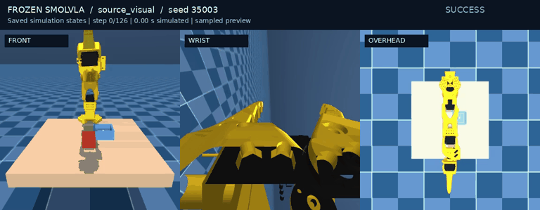
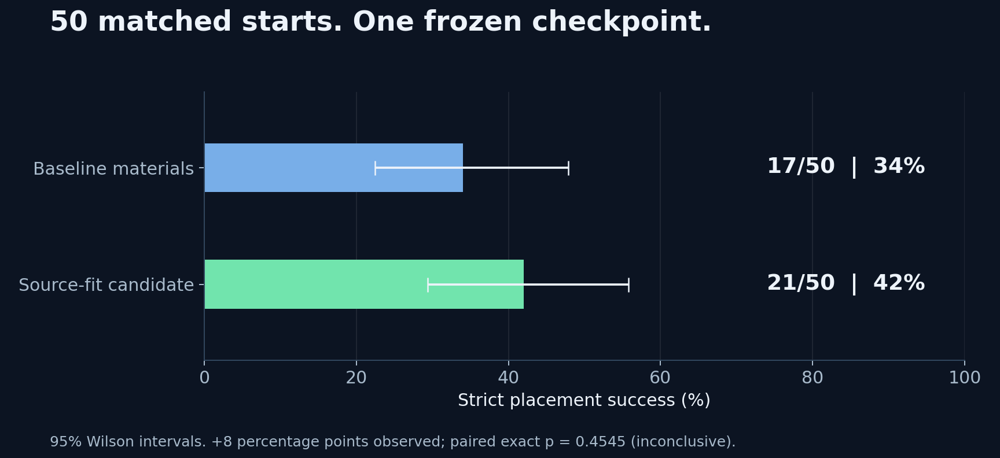

# SmolVLA for SO-101 pick-and-place

Fine-tuning on `gpudad/so101_pick_cube` and evaluating the saved policy in a three-camera MuJoCo simulation.



**[Read the write-up](https://ndsmn.github.io/smolVLA/)** · **[Watch the simulation demo](docs/demo.mp4)** · **[Technical report](docs/output/pdf/so101_smolvla_report.pdf)** · **[Architecture](docs/architecture.md)**

## Setup

A fine-tuned SmolVLA policy receives three RGB views, six joint angles and a task instruction, predicts 50 absolute joint targets, then executes 25 before observing again. A Gymnasium wrapper integrates the policy with an attributed SO-101 MuJoCo replica. Evaluation records complete action/state traces and distinguishes approach, jaw contact, lift, transport and stable placement.

Fine-tuning completed 40,000 optimizer updates on a Threadripper PRO workstation with an NVIDIA RTX 6000 Ada 48 GB GPU. The local RTX 3060 laptop GPU (6 GB) was used for inference and evaluation; no local retraining was needed for the material/rendering study.

## Results

| Measurement | Result | Interpretation |
|---|---:|---|
| Base → 40k held-out action MAE | 0.2124 → 0.0455 rad | **78.6% relative error reduction**, 128 distinct trajectory anchors |
| Main upstream placement rate | 17/50, **34%** | Frozen 40k checkpoint, original MSAA-4 rendering |
| Main candidate placement rate | 21/50, **42%** | Same 50 starts; 95% Wilson interval 29.4–55.8% |
| Candidate lift rate | 41/50, **82%** | Intermediate stage, not completed placement |
| Paired material comparison | Exact p = **0.4545** | Improvement is inconclusive |
| Material/rendering study | **200 rollouts** | Two materials × two render settings × 50 starts |



Lower offline action error does not imply the same percentage of completed tasks. An earlier reconstruction produced 0/50 final successes; scene/reset changes prevent a controlled before/after comparison with this replica. This is a simulation study, not a physical-robot benchmark.

## Implementation

The implementation includes the dataset audit and repair workflow, duplicate-group split, fine-tuning telemetry, named joint/camera integration, frozen-policy runner, stage instrumentation, paired experiments, metric correction audit and rendering sensitivity investigation.

External components are credited explicitly: [Hugging Face SmolVLA/LeRobot](https://github.com/huggingface/lerobot), [gpudad/so101_pick_cube](https://huggingface.co/datasets/gpudad/so101_pick_cube), [Rovo Labs’ SO-101 replica](https://github.com/Rovo-Labs/so-arm101-pick-place) and [MuJoCo](https://github.com/google-deepmind/mujoco). The scene is pinned to `f27633c80eb6d852049fafb7c72a9584ec944ba7`. See [credits](docs/CREDITS.md).

## Explore the repository

| Path | Contents |
|---|---|
| [`docs/`](docs/) | Illustrated project article, demo, PDF, plots and machine-readable evidence |
| [`env_rebuild/`](env_rebuild/README.md) | Portable export of the replica wrapper, frozen-policy runner, paired evaluation and verification |
| [`training/`](training/README.md) | Training/preparation source, split, repair evidence and training recipe |
| [`docs/evidence/`](docs/evidence/) | All 100 main physical traces, 200 outcome records, metrics and audit records |
| [`scripts/verify_evidence.py`](scripts/verify_evidence.py) | Recompute reported results, check links and verify exported artifact hashes without a GPU |

### Preview the article

```bash
python3 -m http.server 8000 --directory docs
```

Open `http://localhost:8000`. There is no frontend build step or external font service.

### Verify the evidence

```bash
python3 scripts/verify_evidence.py
```

This checks the exported records; it does not run a new policy experiment. Videos are rerenders of saved simulation states. Selected success/failure examples have trace hashes and selection rules in [the proof manifest](docs/assets/proof/manifest.json).

### Run inference

See the [inference guide](env_rebuild/README.md). You need the fine-tuned checkpoint, saved processors and tokenizer assets. **Weights are not included or publicly hosted by this repository.** The expected checkpoint hash is recorded, so a base model cannot silently stand in for the reported fine-tuned policy. The full training dataset is unnecessary for inference.

## Training and checkpoints

The repaired corpus contains 10,991 episodes / 1,445,747 frames. The split holds exact numeric-trajectory duplicates together: 9,911 training and 1,080 validation episodes. Numeric normalization uses training frames only.

The training recipe used batch 32, AdamW at initial learning rate 1e-4, 1,000 warmup steps, BF16 through Accelerate and a 50-step action chunk. The vision encoder was frozen and the action expert was fine-tuned. Eight checkpoints were saved every 5,000 steps. Training took approximately 16 h 3 min on the Threadripper PRO / RTX 6000 Ada 48 GB workstation. Inference used the RTX 3060 6 GB.

The 40k checkpoint was selected by the offline-error tie-breaker after all checkpoints tied at zero successes in the older simulator. Full checkpoint measurements are in [offline_checkpoint_metrics.json](docs/evidence/offline_checkpoint_metrics.json); actual update logs and configuration are in [evidence/training](docs/evidence/training/).

## How success is measured

Strict placement requires a prior 4 cm lift, all rotated cube corners contained in bin XY with a disclosed 0.1 mm numerical contact tolerance, floor-height compatibility, release from robot contact, and low velocity for 15 consecutive control steps. Floor compatibility is a geometric support proxy. Jaw contact alone is not a secure grasp.

The numerical-tolerance audit exactly replayed 100 old action traces before changing how their outcomes were measured. It changes measurement, not robot behaviour. See [the metric audit](docs/evidence/metric_correction.json).

## Limitations and next work

- The original simulator was not recovered; source-action replay validation remains mixed.
- Material selection used one source episode. Its observed success-rate difference is inconclusive.
- Tiny anti-aliasing image differences can affect BF16 actions. Independent-process and cross-hardware exact repetition are untested.
- Physics pauses during inference; physical-robot transfer and real-time hardware control are unvalidated.
- The current study is exploratory. Freeze future changes before evaluating on a larger fresh seed set.

Next steps are multi-episode observation/controller validation, release/contact diagnostics, a separately measured recovery controller and a larger independent paired study.

## License

Apache-2.0; third-party notices and component attribution are retained. This project does not claim authorship of SmolVLA, the public demonstrations or the upstream scene assets.
